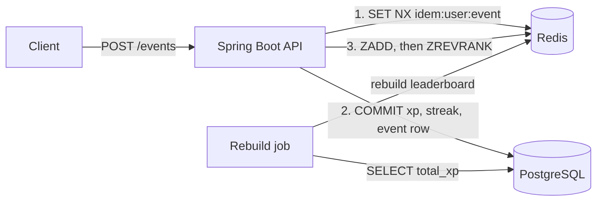
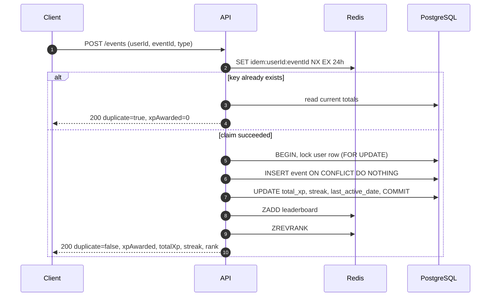
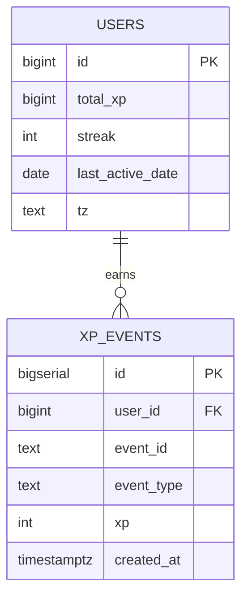

# XP Engine

**A gamification backend: XP awards, daily streaks and a live leaderboard, built so that retries, concurrency and cache outages cannot corrupt a player's score.**


When a player finishes a lesson in an app like Duolingo, the phone sends one message and the server decides everything else: how much XP it is worth, whether the daily streak continues, and where the player now ranks among everyone. XP Engine is that server.

The interesting part is not the happy path. It is what happens when a phone retries a request after losing signal, when 50 requests for the same player arrive in the same millisecond, or when Redis goes down in the middle of traffic. This project is built, tested and measured around those cases.

## Highlights

| | |
|---|---|
| **Exactly one award per event** | 50 parallel retries of one event produced 1 award and 49 duplicates (JUnit test). |
| **No lost updates** | 50 parallel distinct events for one user produced the exact expected total of 2,500 XP. |
| **Fast ranks at scale** | On 1M users, Redis `ZREVRANK` answered at **p50 1.5 ms / p99 2.4 ms** versus **32.0 ms / 41.2 ms** for an indexed PostgreSQL count (about 21x faster at p50). |
| **Survives a cache outage** | With Redis stopped, XP is still awarded and `rank` comes back `null`. A rebuild restores a 1M-user leaderboard from PostgreSQL in **8.1 s**. |
| **Tamper-proof XP** | The client sends an event type, never an amount. |

## Table of contents

- [Architecture](#architecture)
- [How a request is processed](#how-a-request-is-processed)
- [Design decisions](#design-decisions)
- [API reference](#api-reference)
- [Data model](#data-model)
- [Getting started](#getting-started)
- [Configuration](#configuration)
- [Testing](#testing)
- [Benchmark: rank lookup at 1M users](#benchmark-rank-lookup-at-1m-users)
- [Load test](#load-test)
- [Failure modes](#failure-modes)
- [Project structure](#project-structure)
- [Troubleshooting](#troubleshooting)
- [Known limitations and roadmap](#known-limitations-and-roadmap)
- [Author](#author)

## Architecture

PostgreSQL is the **source of truth**. Redis is a **derived view** that exists only to make rank lookups fast, and it can be thrown away and rebuilt at any time.



| Component | Responsibility |
|---|---|
| `XpController` | REST endpoints, request validation |
| `XpService` | The award flow: idempotency claim, transaction, leaderboard update |
| `StreakCalculator` | Pure function that computes the next streak value from dates |
| `LeaderboardService` | All Redis sorted-set operations, with graceful degradation |
| `RebuildService` | Scheduled job that rebuilds the leaderboard from PostgreSQL |
| Flyway (`V1__init.sql`) | Versioned schema, so every environment builds the same database |

## How a request is processed



1. **Claim the event.** `SET NX` on `idem:{userId}:{eventId}` (24 h expiry) is one atomic step. If the key already exists, this is a retry: return `duplicate: true` and award nothing.
2. **Commit to PostgreSQL first.** In one transaction the user's row is locked (`SELECT ... FOR UPDATE`), the event is inserted with `ON CONFLICT DO NOTHING`, and the total XP and streak are updated.
3. **Update Redis second.** `ZADD` writes the new total into the sorted set. A failure here never fails the request.
4. **Return the rank.** `ZREVRANK` runs after the commit and returns the 1-based rank, or `null` if Redis is unavailable.

If the database write throws, the Redis claim key is released so the client's retry is not wrongly rejected.

## Design decisions

| Decision | Why | What it protects against |
|---|---|---|
| **Server decides XP** from the event type | The client is untrusted | A client sending `"xp": 999999` |
| **Atomic `SET NX`**, scoped per user and event | "Check the key, then save it" is a race: two simultaneous retries can both pass the check | Double XP under concurrent retries |
| **`UNIQUE(user_id, event_id)`** in PostgreSQL | Redis keys expire and caches get wiped. The database constraint cannot be raced | Double XP after a Redis outage or key expiry |
| **Duplicate returns 200**, not 400 | To the client a retry is a success. An error makes apps retry again or show a false failure | Retry storms, confusing client behavior |
| **PostgreSQL commit before Redis update** | If the DB write fails, nothing downstream has changed | A leaderboard that is ahead of the truth |
| **Row lock** (`SELECT ... FOR UPDATE`) | Concurrent events for one user read-modify-write the same total | Lost updates |
| **Redis failure is non-fatal** | A cache outage should not be a product outage | Awards failing because of a derived view |
| **Scheduled rebuild** from PostgreSQL | Any drift in Redis is repaired from the source of truth | Permanent leaderboard inconsistency |
| **Rebuild into a temp key, then `RENAME`** | Readers never see an empty or half-built leaderboard | Rank gaps during a rebuild |
| **Streak uses the user's own timezone** | "Today" differs per user | Unfair streak resets near midnight |
| **Pure `StreakCalculator`** | No clock or database inside, so it is trivially unit-testable | Streak bugs at month boundaries |

### Streak rules

| Situation | Result |
|---|---|
| First ever event | streak = 1 |
| Another event on the same local day | unchanged |
| Event on the next local day | streak + 1 |
| One or more days missed | reset to 1 |

### XP values

| Event type | XP |
|---|---|
| `LESSON_COMPLETED` | 50 |
| `QUIZ_PASSED` | 30 |
| `DAILY_LOGIN` | 10 |

## API reference

Base URL: `http://localhost:8080`

### `POST /events`

Records an event and awards XP.

Request body:

```json
{ "userId": 1, "eventId": "evt-1", "type": "LESSON_COMPLETED" }
```

| Field | Type | Notes |
|---|---|---|
| `userId` | number | Must exist in `users` |
| `eventId` | string | Idempotency key, unique per user. Reuse it when retrying |
| `type` | enum | `LESSON_COMPLETED`, `QUIZ_PASSED`, `DAILY_LOGIN` |

First call:

```json
{ "duplicate": false, "xpAwarded": 50, "totalXp": 50, "streak": 1, "rank": 1 }
```

Retry of the same `eventId` (still HTTP 200, nothing awarded):

```json
{ "duplicate": true, "xpAwarded": 0, "totalXp": 50, "streak": 1, "rank": 1 }
```

`rank` is `null` when Redis is unavailable. A malformed body returns 400. An unknown `userId` currently surfaces as a 500 (see [roadmap](#known-limitations-and-roadmap)).

### `GET /leaderboard/top?n=10`

Top `n` players by XP (default 10, capped at 100).

```json
[ { "userId": "1", "xp": 80.0 }, { "userId": "2", "xp": 30.0 } ]
```

### `GET /users/{id}/rank`

```json
{ "rank": 1 }
```

Returns `{}` if Redis is unavailable or the user is not on the leaderboard.

### `POST /admin/leaderboard/rebuild`

Rebuilds the Redis leaderboard from PostgreSQL and returns the number of users loaded.

```json
{ "users": 2 }
```

> This endpoint is unauthenticated. Do not expose it publicly (see [roadmap](#known-limitations-and-roadmap)).

## Data model



- `users.total_xp` has an index (`idx_users_total_xp`, descending) so top-N queries are fast.
- `xp_events` has `UNIQUE (user_id, event_id)`. It doubles as an audit trail: every award is one row.
- Redis holds two kinds of keys: `idem:{userId}:{eventId}` (24 h expiry) and the sorted set `leaderboard:xp`.

## Getting started

### Prerequisites

- JDK 21 or newer
- Maven 3.9+ (or run everything from IntelliJ IDEA)
- Docker with Docker Compose

### 1. Start PostgreSQL and Redis

```bash
docker compose up -d
```

### 2. Run the tests

```bash
mvn test
```

The unit tests need nothing else. The concurrency tests use the containers from step 1 and a throwaway user (`id 9001`) that they clean up afterwards.

### 3. Start the app

```bash
mvn spring-boot:run
```

Flyway creates the tables on first start.

### 4. Create players

```bash
docker compose exec postgres psql -U xp -d xp -c "INSERT INTO users (id) VALUES (1), (2);"
```

### 5. Send events

**macOS / Linux**

```bash
curl -s -X POST localhost:8080/events -H 'Content-Type: application/json' \
  -d '{"userId":1,"eventId":"evt-1","type":"LESSON_COMPLETED"}'
```

**Windows PowerShell**

```powershell
Invoke-RestMethod -Method Post -Uri http://localhost:8080/events -ContentType "application/json" `
  -Body '{"userId":1,"eventId":"evt-1","type":"LESSON_COMPLETED"}'
```

Run the same command twice. The second response shows `duplicate: true` and `xpAwarded: 0`.

### 6. Try the failure drill

```bash
docker compose stop redis        # simulate a cache outage
# send a new event: it still returns 200 with XP awarded, and rank is null
docker compose start redis
curl -X POST localhost:8080/admin/leaderboard/rebuild
curl localhost:8080/leaderboard/top
```

After the rebuild, the leaderboard matches PostgreSQL again. If the rebuild call fails right after Redis restarts, wait 10 to 15 seconds for the client to reconnect and call it again.

## Configuration

`src/main/resources/application.yml`:

| Property | Default | Purpose |
|---|---|---|
| `spring.datasource.url` | `jdbc:postgresql://localhost:5432/xp` | PostgreSQL connection |
| `spring.datasource.username` / `password` | `xp` / `xp` | Credentials from `docker-compose.yml` |
| `spring.data.redis.host` / `port` | `localhost` / `6379` | Redis connection |
| `spring.data.redis.timeout` | `200ms` | Fail fast, so a slow Redis degrades `rank` instead of blocking awards |
| `xp.rebuild.interval` | `PT15M` | Delay between leaderboard rebuilds |
| `xp.rebuild.initial-delay` | `PT1M` | Delay before the first rebuild after startup |

`docker-compose.yml` starts Redis with `--lazyfree-lazy-server-del yes`, so deleting or replacing a large key (such as a 1M-member leaderboard) happens in the background instead of stalling Redis.

## Testing

| Suite | What it proves |
|---|---|
| `StreakCalculatorTest` (6 tests) | First event, same day, next day, one missed day, many missed days, month boundary |
| `XpServiceConcurrencyTest` (3 tests) | See below |
| `RankBenchmarkTest` | Redis vs PostgreSQL rank lookup at 1M users. Skips itself unless at least 100,000 users are seeded |

`XpServiceConcurrencyTest` releases all threads at the same instant with a `CountDownLatch`:

1. **Same event, 50 parallel retries** results in exactly 1 award, a total of 50 XP, and 1 row in `xp_events`.
2. **50 different events in parallel for one user** results in an exact total of 2,500 XP and 50 rows, so no update was lost.
3. **Redis key deleted before a retry** still blocks the duplicate, which proves the PostgreSQL constraint works as the backstop.

<!-- VERIFY before publishing: your resume mentions "crash-window recovery tests". If a test for the case "app dies after the Redis claim but before the PostgreSQL commit" is committed, add it as item 4 above. If it is not committed, remove that phrase from the resume or add the test. -->

## Benchmark: rank lookup at 1M users

**Question:** How long does “what is this player's rank?” take when a million players are competing?

### Method

- **Dataset:** 1,000,001 users — 1,000,000 seeded by `bench/seed.sql` (IDs 1000 to 1000,999, random XP up to 1e9) plus one hand-made test user, loaded into PostgreSQL and then into Redis.
- **Rank lookups:** 2,000 randomly chosen users, queried one at a time after 300 unmeasured warm-up lookups.
- **PostgreSQL:** `SELECT COUNT(*) + 1 FROM users WHERE total_xp > (SELECT total_xp FROM users WHERE id = ?)` with an index on `total_xp`.
- **Redis:** `ZREVRANK` on the sorted set.
- **Percentiles:** Calculated from sorted raw timings, not averages.
- **Environment:** Windows 11, 16 cores, Java 26.0.2, PostgreSQL 16 and Redis 7 in Docker on the same laptop, with the app in the same JVM as the benchmark.

### Results

| Query | p50 | p99 | Mean |
|---|---:|---:|---:|
| Rank, PostgreSQL (indexed `COUNT`) | 31.983 ms | 40.909 ms | 32.194 ms |
| Rank, Redis (`ZREVRANK`) | **1.556 ms** | **2.511 ms** | **1.619 ms** |
| **Rank speed-up** | **20.6×** | **16.3×** | — |
| Top-10, PostgreSQL (`ORDER BY ... LIMIT 10`) | 1.264 ms | 2.192 ms | 1.320 ms |
| Top-10, Redis (`ZREVRANGE`) | 1.282 ms | 2.227 ms | 1.346 ms |

The table shows one run. The raw output is available in [`bench/results.txt`](bench/results.txt). Timings vary between runs, so treat the speed-up as approximately **20× at p50**, not an exact guarantee.

### What this tells you

- PostgreSQL rank lookup uses a count of users with higher XP. Redis retrieves a player's position directly from a sorted set, making it substantially faster in this benchmark.
- Redis rank lookups were **20.6× faster at p50** and **16.3× faster at p99** than the PostgreSQL query in this run.
- Top-10 query latency was nearly identical on both systems. Redis's main performance advantage here is per-user rank lookup, not top-N retrieval.
- The design keeps PostgreSQL as the source of truth for durability and Redis as a rebuildable leaderboard cache for fast rank lookups.

### Limits of this measurement

- One machine, with the app, PostgreSQL and Redis sharing CPU and memory. Absolute timings will differ elsewhere.
- Lookups run sequentially in a single thread. This measures latency, not behavior under heavy parallel load.
- Random XP values over a wide range make ties relatively rare. Real populations with many tied scores may behave differently.
- The latest run reported **0 rank differences across 2,000 sampled users**. This does not establish that ties can never cause rank differences; PostgreSQL and Redis can handle tied scores differently.

### Reproduce

```bash
# 1. Seed 1M users (macOS / Linux)
docker compose exec -T postgres psql -U xp -d xp < bench/seed.sql

# Windows PowerShell
Get-Content bench/seed.sql | docker compose exec -T postgres psql -U xp -d xp

# 2. Stop the app, then run the benchmark
mvn test -Dtest=RankBenchmarkTest
```

The benchmark disables the scheduled rebuild for its own run so that a background rebuild cannot interfere with the timings. The first run also loads the leaderboard into Redis.
## Load test

<!-- VERIFY before publishing: the figures below come from your resume. bench/load.js is in the project, but I have not seen its contents or the run output. Save the end-of-run summary next to it (for example bench/load-results.txt), make these numbers match it exactly, and add the command used to run it. If the numbers do not match a real run, correct the table and the resume bullet. -->

Local run against the running API, script in [`bench/load.js`](bench/load.js):

### Latest k6 Load Test Results

- **Virtual users:** 50
- **Duration:** 2 minutes
- **Total requests:** 107,894
- **Throughput:** 899.1 requests/second
- **Average latency:** 41.58 ms
- **Median latency (p50):** 45.77 ms
- **p95 latency:** 60.55 ms
- **Failed HTTP requests:** 0%
- **Successful checks:** 107,894 / 107,894 (100%)

Tested locally using `k6 run bench/load.js`.

These numbers describe a local environment (API, PostgreSQL, Redis and the load generator on one machine). They are not a capacity claim for production.

## Failure modes

| What goes wrong | What happens | Why it is safe |
|---|---|---|
| Client retries the same event | `200`, `duplicate: true`, nothing awarded | Atomic `SET NX`, plus the unique constraint |
| 50 retries arrive at the same instant | Exactly one is the real award | `SET NX` lets one claim win; the constraint covers the rest |
| Redis is down during an award | XP is awarded, `rank` is `null` | PostgreSQL is the source of truth and the claim step falls through to it |
| Redis loses an idempotency key | A retry is still rejected | `UNIQUE(user_id, event_id)` in PostgreSQL |
| Redis loses the whole leaderboard | Ranks are missing until a rebuild | The scheduled job (or `POST /admin/leaderboard/rebuild`) restores it from PostgreSQL in about 8 s at 1M users |
| PostgreSQL write fails mid-request | Error returned, claim key released | The retry can succeed; the leaderboard was never touched |
| Two events for one user race | Totals add up exactly | Row lock on the user serializes them |
| Rebuild runs while traffic continues | Readers see the old or the new board, never a partial one | Built under a temp key, swapped with `RENAME` |

## Project structure

```
xp-engine/
├── docker-compose.yml                 PostgreSQL 16 and Redis 7
├── pom.xml
├── bench/
│   ├── seed.sql                       seeds 1M users for the rank benchmark
│   ├── load.js                        load-test script
│   └── results.txt                    raw output of the benchmark run above
└── src/
    ├── main/
    │   ├── java/com/xpengine/
    │   │   ├── XpEngineApplication.java
    │   │   ├── XpController.java      REST endpoints
    │   │   ├── XpService.java         award flow and idempotency
    │   │   ├── LeaderboardService.java
    │   │   ├── RebuildService.java    scheduled leaderboard rebuild
    │   │   ├── StreakCalculator.java  pure streak logic
    │   │   ├── EventType.java         XP per event type
    │   │   ├── EventRequest.java
    │   │   └── EventResponse.java
    │   └── resources/
    │       ├── application.yml
    │       └── db/migration/V1__init.sql
    └── test/java/com/xpengine/
        ├── StreakCalculatorTest.java
        ├── XpServiceConcurrencyTest.java
        └── RankBenchmarkTest.java
```

## Troubleshooting

**`invalid value for parameter "TimeZone": "Asia/Calcutta"` on startup**
Windows reports India's legacy timezone name to Java, and PostgreSQL 16 rejects it. The app sets `Asia/Kolkata` as the JVM default in `XpEngineApplication.main`, and the tests do the same in a static block.

**`mvn` is not recognized (Windows)**
Install Maven and add its `bin` folder to `PATH`, or run the tests and the app from IntelliJ IDEA, which bundles Maven.

**Port 8080 already in use**
Stop any running copy of the app. The concurrency tests and the benchmark start their own application context.

**`Redis command timed out after 200 millisecond(s)`**
Redis was busy, for example freeing a very large key. The rank comes back `null` by design. The compose file enables lazy freeing to avoid this, and the benchmark disables the scheduled rebuild so it cannot overlap with measurements.

**The rebuild endpoint returns 500 right after `docker compose start redis`**
The Redis client is still reconnecting. Wait 10 to 15 seconds and call it again.

**Test or class shows red in IntelliJ with "outside of the module source root"**
Test classes must live under `src/test/java/com/xpengine`, not under `src/main` or the project root.

**The benchmark test is skipped**
Fewer than 100,000 users are in the database. Run the seed script first.

## Known limitations and roadmap

**Known limitations**

- Concurrency was verified on a single application instance with 50 threads. The design should hold with several instances, since the claim and the row lock live in shared Redis and PostgreSQL, but this has not been tested.
- The benchmark and load test ran on one laptop, as described above.
- No authentication or rate limiting. The admin rebuild endpoint is open.
- An unknown `userId` returns a 500 instead of a 404.
- Redis orders tied scores by member name, so tied players can get different ranks from it.

<!-- VERIFY: if the crash-window case (app dies after the Redis claim, before the PostgreSQL commit) is NOT handled in XpService, add here: "A retry within 24 hours of such a crash is treated as a duplicate, so that one award can be lost (never doubled)." If it IS handled, describe the mechanism in the design table above. -->

**Roadmap**

- Streak freeze: if exactly one day was missed and the user holds a freeze, spend it instead of resetting.
- Achievements and badges with a `UNIQUE(user_id, achievement_id)` constraint for safe, duplicate-proof unlocks.
- Proper error mapping (404 for unknown users) and request authentication.
- A multi-instance concurrency test, and a deployed environment (for example AWS with a managed database and cache).

## Author

**Santhosh Sharma**
[GitHub](https://github.com/santhoshsharrma) · [LinkedIn](https://linkedin.com/in/santhoshsharma)
